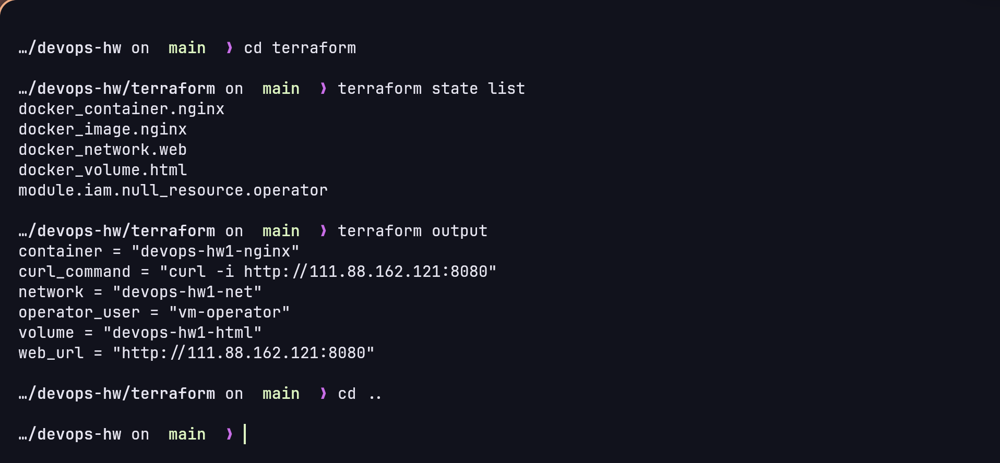
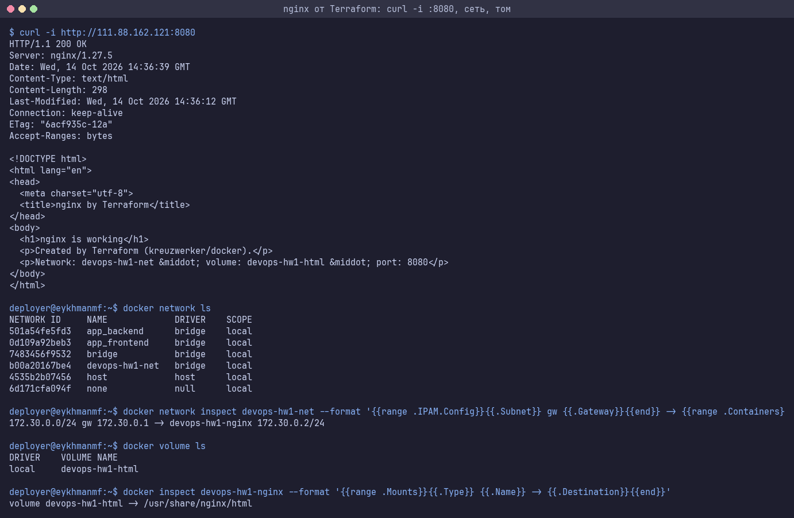
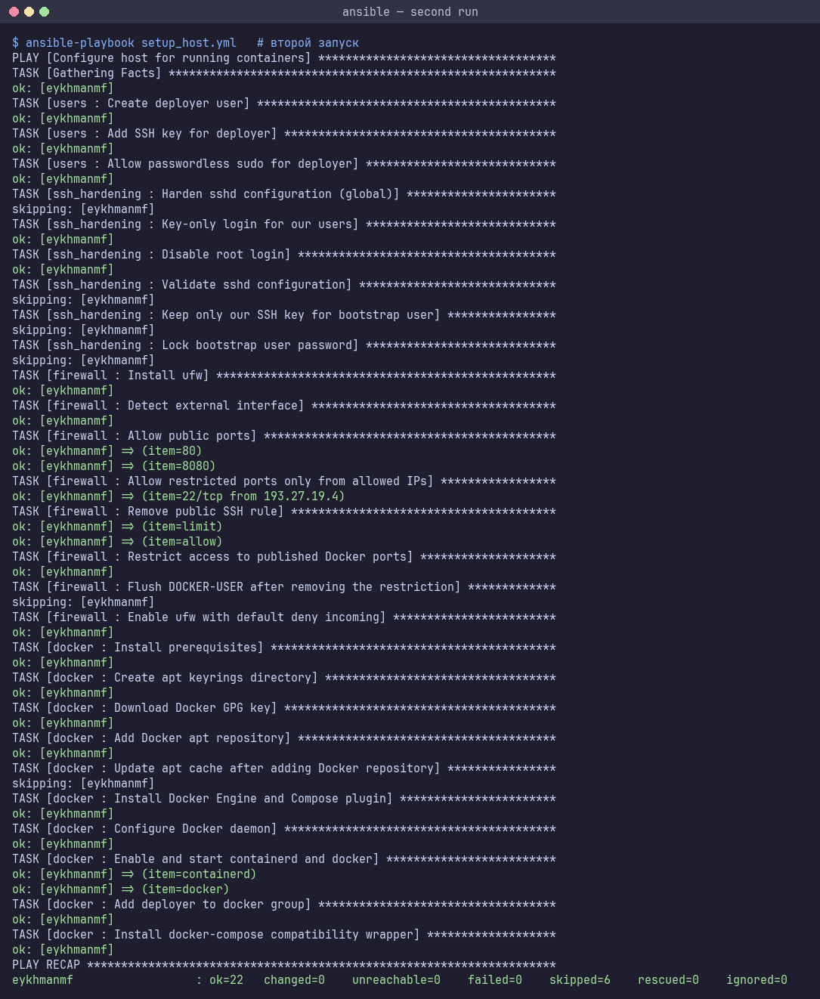
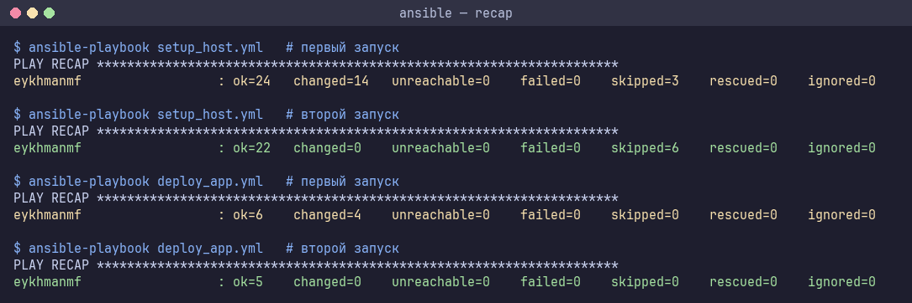
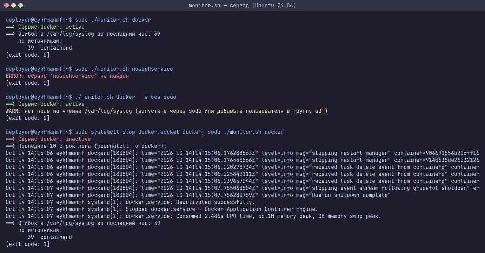
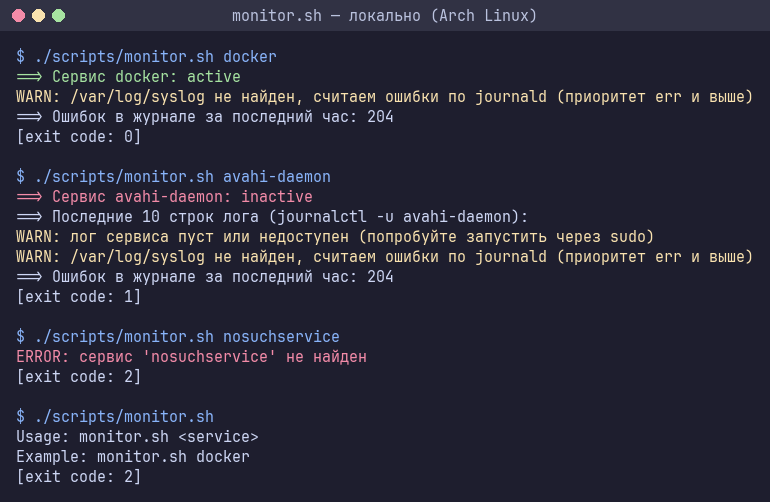
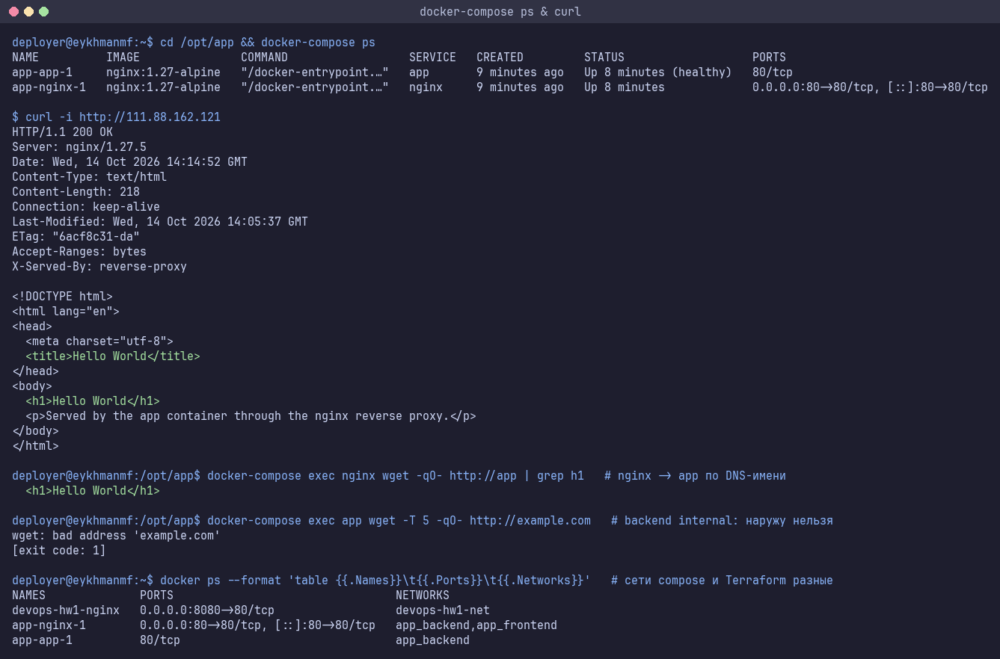
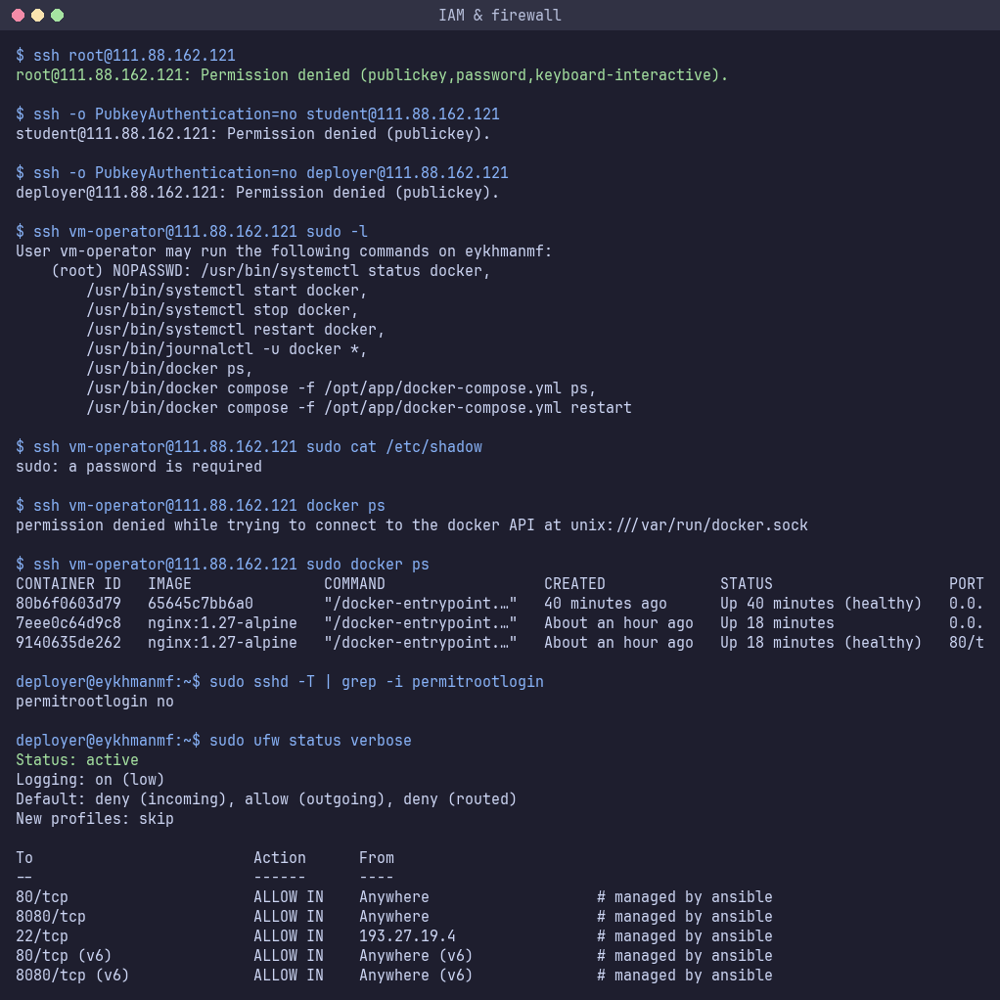
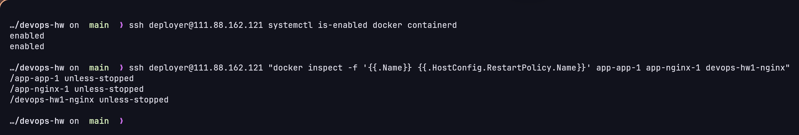

# ДЗ 1: Фундамент DevOps-инфраструктуры

Сервер: `111.88.162.121` (Ubuntu 24.04), пользователь `student`.

Что сделано:
- **Ansible** - пользователь `deployer`, docker + compose, ufw
- **Terraform** (провайдер `kreuzwerker/docker`) - сеть, том и nginx на порту 8080, пользователь `vm-operator`
- **Docker Compose** - nginx (reverse proxy) + app (hello world) на порту 80
- **monitor.sh** - статус сервиса, лог, ошибки в syslog за час

Сначала запускается ansible (ставит docker), потом terraform.

## Структура

```
ansible/
  inventory.ini
  group_vars/        all.yml, uni.yml
  setup_host.yml     роли users, ssh_hardening, firewall, docker
  deploy_app.yml     роль app (compose в /opt/app)
  roles/
terraform/
  main.tf            сеть, том, образ, контейнер nginx
  providers.tf versions.tf variables.tf outputs.tf
  files/index.html.tftpl
  modules/iam/       пользователь vm-operator
app/                 docker-compose.yml, конфиг nginx, index.html
scripts/monitor.sh
docs/                скриншоты и логи
```

## Запуск

Нужны ansible, terraform и ssh ключ на сервере (`ssh-copy-id student@111.88.162.121`).

**1. Ansible**
```bash
cd ansible
ansible-galaxy collection install -r requirements.yml
ansible all -m ping
ansible-playbook setup_host.yml
ansible-playbook setup_host.yml   # второй раз changed=0
```

**2. Terraform**
```bash
cd terraform
terraform init
terraform plan -out tfplan
terraform apply tfplan
curl -i http://111.88.162.121:8080
```
Если registry.terraform.io не открывается: `export TF_CLI_CONFIG_FILE=$PWD/terraformrc.example`.

**3. Docker Compose**
```bash
cd ansible
ansible-playbook deploy_app.yml
curl -i http://111.88.162.121
```
или руками на сервере:
```bash
ssh deployer@111.88.162.121
cd /opt/app && docker-compose up -d && docker-compose ps
```

**4. monitor.sh**
```bash
./scripts/monitor.sh docker
scp scripts/monitor.sh deployer@111.88.162.121:~
ssh deployer@111.88.162.121 'sudo ./monitor.sh docker'
```

**Удалить**
```bash
cd terraform && terraform destroy
ssh deployer@111.88.162.121 'cd /opt/app && docker-compose down'
```

## Скриншоты

Полные логи в [docs/outputs](docs/outputs/).

terraform state list / output:



nginx от terraform (curl -i на 8080, сеть, том):



ansible, второй запуск:





monitor.sh на сервере:



monitor.sh локально (на arch нет /var/log/syslog, поэтому считает по journalctl):



docker-compose ps и curl:



пользователи и firewall:



автозапуск:



## Решения

**Terraform.** Провайдер docker подключается к серверу по ssh под `deployer` (он в группе docker, sudo не нужен), docker api наружу не открывается. В `main.tf`:
- `docker_network` - отдельная сеть `devops-hw1-net` (172.30.0.0/24)
- `docker_volume` - том `devops-hw1-html`, в нём лежит index.html
- `docker_image` - nginx:1.27-alpine, `keep_locally` чтобы destroy не удалял образ (его использует compose)
- `docker_container` - nginx в этой сети с томом, порт 8080 (80 занят compose)

Compose живёт в своих сетях `app_frontend` и `app_backend`. State хранится локально, в гит не коммитится.

**Пользователи.**
- `student` - под ним работает ansible
- `deployer` - sudo без пароля, группа docker, под ним terraform
- `vm-operator` - создаётся terraform, через sudo может только смотреть и перезапускать docker (`systemctl`, `journalctl`, `docker ps`, `docker compose ps/restart`)

Для `student` и `deployer` вход по ssh только по ключу (`Match User` в sshd). Вход под root по ssh запрещён (`PermitRootLogin no`).

**Firewall (ufw).** Всё входящее закрыто. SSH (22) только с моего IP (`allowed_ips` в `group_vars/uni.yml`), 80 и 8080 открыты всем - это сайты. Порт контейнера app наружу не опубликован. Если IP поменялся - добавить новый в `allowed_ips` и запустить `setup_host.yml` со старого.

**Ansible.** Роли, модули вместо shell (command только для проверки `sshd -t`), поэтому второй запуск `changed=0`. Docker ставится из официального репозитория. Для команды `docker-compose` из задания сделана обёртка над `docker compose`.

**Compose.** Наружу торчит только nginx. app в сети backend с `internal: true`, у него нет выхода в интернет. nginx стартует после healthcheck app.

**monitor.sh.** Коды выхода: 0 - работает, 1 - не работает, 2 - ошибка (нет аргумента / сервис не найден). Ошибки за час: строю префиксы времени за последние 60 минут (`date`), `grep -F` отбирает строки за час, `awk` считает строки с error и группирует по программе. Понимает оба формата syslog (`Oct 14 14:13:15` и `2026-10-14T14:13:15`). Если syslog нет - считает через `journalctl -p err`.

## Проблемы

- Сначала делал VM в VirtualBox через провайдер `shekeriev/virtualbox`, apply висел 5 минут и падал: провайдер ждёт IP на всех сетевых картах, а образ настраивает только первую. Потом выдали сервер и сказали использовать docker провайдер, virtualbox убрал.
- `terraform plan` после apply каждый раз хотел пересоздать сеть - docker сам ставил gateway. Задал `gateway` явно.
- Docker публикует порты в обход ufw. Когда 80/8080 были только с моего IP, фильтровал в цепочке `DOCKER-USER`. После открытия портов в iptables остались старые правила, `ufw reload` их не чистит - добавил flush.
- Пока 22 был открыт всем с `ufw limit`, при закрытии по IP старое правило оставалось (ufw не удаляет правила сам) - добавил задачу, которая его удаляет. Перед изменением ставил таймер `systemd-run --on-active=15min ufw limit 22/tcp`, чтобы не потерять ssh, если что-то пойдёт не так.
- `ufw limit` начал резать мои ssh подключения, когда делал много команд подряд. Сделал одно соединение (`ControlMaster`), в том числе для terraform.
- `ansible_managed` не работает в `copy`, только в `template`.
- ansible 2.21 ругался на `apt_repository` - заменил на `deb822_repository` (нужен пакет python3-debian).
- monitor.sh считал ошибками строки `level=info ... error=...` от docker - исключил info/warning.
- grep без совпадений возвращает 1 и с `pipefail` скрипт падал - добавил `|| true`.

## Вопросы

1. **Императивный и декларативный подход.** Bash - пишешь как делать, по шагам. Terraform - пишешь какой результат нужен, он сам считает разницу (plan) и применяет. Ansible выполняет задачи по порядку, но модули описывают состояние (`state: present`).
2. **Зачем state.** В нём связь между кодом и реальными объектами (id сети, тома, контейнера). Без него terraform не знает что уже создано: plan предложит создать всё заново, а apply упадёт, потому что сеть с таким именем уже есть. Придётся делать `terraform import` или удалять руками.
3. **Идемпотентность.** Повторный запуск ничего не меняет. Модули ansible сначала проверяют текущее состояние. Проверял вторым запуском playbook - `changed=0`. У terraform то же самое - `No changes` на повторном plan.
4. **Ошибки в monitor.sh.** Нет аргумента - usage и код 2. Сервис не найден - сообщение и код 2. Лог пустой или нет прав - предупреждение. Нет /var/log/syslog - считает через journalctl. Нет прав на syslog - пишет запустить через sudo.
5. **Security group.** Всё закрыто кроме 22, 80, 8080. SSH только с моего IP, вход только по ключу, root запрещён - так убирается перебор паролей и доступ с чужих адресов. 80 и 8080 - сайты, их надо проверять через curl. Контейнер app наружу не опубликован, docker api наружу не открыт.
